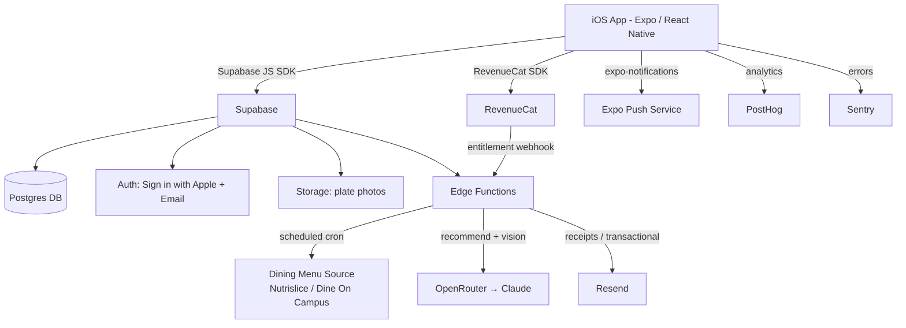

# PRD — MacroMom

> Technical blueprint for building MacroMom. Consumed directly by an AI coding agent (Claude Code + Fable 5). Read alongside `docs/product-vision.md` (strategy, brand, voice) and `docs/design.md` (visual tokens — generate via the Design System skill before implementation).

## 1. Overview

### Product Summary

**MacroMom** — "MacroMom turns your college dining hall menu into a personalized, goal-based meal plan." A native iOS app (Expo / React Native) that scrapes a student's campus dining-hall menus daily, applies a certified macro-nutrition consultant's methodology to the student's goals, and proactively recommends a few ready-to-plate meals that hit their macro targets. Students confirm portions with a quick photo and track progress — with near-zero effort, in the warm voice of a "macro mom."

### Objective

This PRD covers the **MVP** as defined in `docs/product-vision.md § Product Strategy → MVP Definition`: goal-based onboarding with calculated macro targets, Clemson dining-hall menu ingestion, a daily recommendation engine, proactive notifications, a portion-check camera, basic logging/progress, and auth + subscription gating. iOS only. One campus (Clemson) only. Everything in `§ Explicitly Out of Scope` is excluded.

### Market Differentiation

Technically, differentiation lives in two systems that must work well: (1) the **menu ingestion pipeline** that reliably turns each Clemson dining hall's live daily menu into structured, macro-tagged data, and (2) the **recommendation engine** that composes appealing, goal-fitting plates from that real menu. These are the defensible core — a generic tracker cannot replicate them without rebuilding around campus menu data. The implementation must make the menu data trustworthy and current, and the recommendations genuinely good.

### Magic Moment

**MacroMom proactively messages the student with a few ready-to-plate meal options for today at their dining hall; they walk in, plate it, and snap a photo to check portions — no thinking required.** Technically this requires: a reliable scheduled scraper (menus current every day), a fast recommendation engine (2–3 plates in <2s from cached menu + user targets), a well-timed push notification with a deep link straight to today's recommendations, and a portion-photo analysis that returns feedback in a few seconds. The notification → recommendation path must be seamless and fast; the recommendation quality must be high; the portion camera can be the simplest acceptable version.

### Success Criteria

- Time from app open (cold) to today's recommendations visible: **< 3 seconds**.
- Notification tap → recommendation screen rendered: **< 1.5 seconds**.
- Recommendation generation (server, cached menu): **< 2 seconds** p95.
- Portion-photo feedback round-trip: **< 6 seconds** p95.
- Onboarding completion to first macro targets: **< 3 minutes**.
- All P0 functional requirements implemented and manually verified.
- Menu freshness: every configured Clemson hall has a current-day menu by 7:00 AM ET daily.

---

## 2. Technical Architecture

### Architecture Overview



### Chosen Stack

| Layer          | Choice                                     | Rationale                                                                                                                                      |
| -------------- | ------------------------------------------ | ---------------------------------------------------------------------------------------------------------------------------------------------- |
| Frontend       | Expo / React Native                        | Strongest AI-coding-tool fluency; ships iOS now and Android later from one codebase; EAS cloud builds mean no Mac strictly required to ship.   |
| Backend        | Supabase (Edge Functions)                  | Founder already subscribes; one platform for API, scheduled scraping jobs, and photo storage.                                                  |
| Database       | Supabase Postgres                          | Relational model fits structured menu data (halls → meals → stations → items → nutrition).                                                     |
| Auth           | Supabase Auth (Sign in with Apple + email) | Bundled with backend; Apple sign-in expected on iOS.                                                                                           |
| Payments       | RevenueCat (over Apple IAP)                | Apple requires IAP for in-app digital subscriptions; RevenueCat handles trials, receipts, entitlements. Stripe reserved for a future web flow. |
| AI             | OpenRouter (default: Anthropic Claude)     | Single server-side API for recommendations + portion-photo vision; swap models via config, no lock-in.                                         |
| Analytics      | PostHog                                    | Free tier covers early volume; funnels to watch magic-moment conversion.                                                                       |
| Email          | Resend                                     | Transactional email for account flows and receipts.                                                                                            |
| Error tracking | Sentry                                     | Catch crashes in production; init from day one.                                                                                                |

### Stack Integration Guide

**Setup order:**

1. Initialize Expo app (TypeScript, Expo Router, dev client).
2. Create Supabase project; capture URL + anon key + service-role key. Define schema via SQL migrations (see § Data Model).
3. Wire Supabase JS client in the app (`@supabase/supabase-js` with `expo-secure-store` for session persistence). Enable Sign in with Apple in Supabase Auth + Apple Developer config.
4. Set up RevenueCat: create app in RevenueCat dashboard, link App Store Connect, define entitlement `pro` and offering; install `react-native-purchases`.
5. Add OpenRouter access via a Supabase Edge Function only (never call the model from the client — keep the API key server-side).
6. Build the scraper Edge Function + schedule it (Supabase cron / `pg_cron` invoking the function).
7. Add PostHog (`posthog-react-native`), Sentry (`@sentry/react-native`), and Resend (server-side in Edge Functions).

**Known patterns / gotchas:**

- **AI keys server-side only.** All OpenRouter calls go through Edge Functions; the app calls the Edge Function, which calls OpenRouter. Never bundle the key.
- **Sign in with Apple** requires a paid Apple Developer account, an App ID with the capability, and a Services ID; Supabase needs the Apple client id + secret (a signed JWT). Budget setup time.
- **RevenueCat + Supabase user linking:** set the RevenueCat `appUserID` to the Supabase user id so entitlements map to accounts. Verify entitlements server-side via RevenueCat webhook → Edge Function → write subscription status to Postgres; gate on the DB value, not just the client SDK.
- **Push notifications** need an APNs key uploaded to Expo (EAS credentials). Test on a physical device — push doesn't work in the simulator.
- **Scraping resilience:** the menu source HTML/JSON structure can change without notice. Isolate all source-specific parsing in one module; log parse failures to Sentry; alert if a hall has no current-day menu.
- **RLS is mandatory.** Enable Row Level Security on every user-data table; users read/write only their own rows. Menu tables are readable by all authenticated users, writable only by the service role.

**Required environment variables:**

- App (public): `EXPO_PUBLIC_SUPABASE_URL`, `EXPO_PUBLIC_SUPABASE_ANON_KEY`, `EXPO_PUBLIC_POSTHOG_KEY`, `EXPO_PUBLIC_REVENUECAT_IOS_KEY`, `EXPO_PUBLIC_SENTRY_DSN`.
- Edge Functions (secret): `SUPABASE_SERVICE_ROLE_KEY`, `OPENROUTER_API_KEY`, `RESEND_API_KEY`, `REVENUECAT_WEBHOOK_AUTH`, `SENTRY_DSN`.

### Repository Structure

```
macromom/
├── app/                          # Expo Router routes
│   ├── (auth)/                   # Sign-in / onboarding stack
│   │   ├── sign-in.tsx
│   │   └── onboarding/           # Goal, stats, hall selection, targets reveal
│   ├── (tabs)/                   # Main app after auth
│   │   ├── today.tsx             # Daily recommendations (home / magic moment)
│   │   ├── progress.tsx          # Simple weekly progress
│   │   └── settings.tsx          # Account, goal, halls, notifications, subscription
│   ├── plate-camera.tsx          # Portion-check camera modal
│   └── paywall.tsx               # Subscription paywall
├── src/
│   ├── components/
│   │   ├── ui/                   # Design-system primitives (see docs/design.md)
│   │   └── features/             # Recommendation cards, macro rings, plate feedback
│   ├── lib/
│   │   ├── supabase.ts           # Supabase client
│   │   ├── revenuecat.ts         # Purchases config + entitlement checks
│   │   ├── notifications.ts      # expo-notifications registration + handlers
│   │   ├── analytics.ts          # PostHog wrapper
│   │   └── macros.ts             # Client-side macro math helpers
│   ├── hooks/                    # useUser, useRecommendations, useSubscription
│   └── types/                    # Shared TS types (generated from Supabase)
├── supabase/
│   ├── migrations/               # SQL schema migrations
│   └── functions/
│       ├── scrape-menus/         # Scheduled daily scraper
│       ├── recommend/            # Generate plate recommendations (OpenRouter)
│       ├── analyze-plate/        # Portion-photo vision (OpenRouter)
│       ├── revenuecat-webhook/   # Entitlement sync
│       └── send-daily-push/      # Compose + send proactive notifications
├── assets/
├── app.json                      # Expo config (bundle id, plugins, permissions)
├── eas.json                      # EAS build/submit profiles
└── package.json
```

### Infrastructure & Deployment

- **App builds & submission:** EAS Build (iOS) + EAS Submit to App Store Connect. Use `development`, `preview`, and `production` profiles in `eas.json`. Over-the-air updates via EAS Update for JS-only changes.
- **Backend:** Supabase hosted (existing subscription). Edge Functions deployed via Supabase CLI. Migrations applied via `supabase db push`.
- **Scheduling:** `pg_cron` (or Supabase scheduled functions) to run `scrape-menus` daily (~5:30 AM ET) and `send-daily-push` per meal window (e.g. 7:30 AM, 11:00 AM, 4:30 PM ET).
- **Environments:** one Supabase project for dev/staging is acceptable at MVP; add a separate production project before public launch. Store secrets in Supabase function secrets and EAS secrets — never in the repo.

### Security Considerations

- **Auth:** Supabase Auth issues JWTs; the app stores sessions in `expo-secure-store`. Tokens auto-refresh. Sign in with Apple is the primary path.
- **Authorization:** Postgres **Row Level Security** on all user tables (`user_id = auth.uid()`). Menu tables: `select` for authenticated, `insert/update` for service role only.
- **API security:** OpenRouter and Resend keys live only in Edge Functions. The RevenueCat webhook endpoint validates a shared secret (`REVENUECAT_WEBHOOK_AUTH`). Rate-limit `recommend` and `analyze-plate` per user.
- **Input validation:** validate all Edge Function inputs with `zod`. Reject oversized images (cap upload size); strip EXIF/location from plate photos before storage.
- **Data protection:** plate photos in a private Supabase Storage bucket with signed URLs; delete on user account deletion. No medical claims anywhere in copy.
- **Sentry PII scrubbing:** configure Sentry to scrub tokens, emails, and personal data from events and breadcrumbs; never send auth tokens or image contents in error payloads.

### Cost Estimate (first 6 months, < 1000 users)

- **Supabase:** existing paid plan (Pro ~$25/mo) — covers DB, auth, storage, functions at this scale.
- **OpenRouter (Claude):** usage-based. At ~1000 users × ~1 recommendation + occasional plate analysis/day, estimate ~$30–120/mo depending on model tier and caching. Use a cheaper Claude tier for recommendations, reserve stronger models for vision. Cache daily per-hall recommendations to cut cost.
- **RevenueCat:** free up to $2.5k monthly tracked revenue, then ~1% — effectively $0 early.
- **PostHog:** free tier (1M events/mo) covers early volume — $0.
- **Resend:** free tier (3,000 emails/mo) covers transactional — $0.
- **Sentry:** free developer tier covers early error volume — $0.
- **Apple Developer Program:** $99/year.
- **Estimated monthly total:** ~$55–150/mo plus Apple's annual fee.

### Menu Ingestion Architecture (multi-campus)

The menu pipeline is the core data asset and must scale from Clemson to hundreds of campuses that use different menu vendors with varying nutrition completeness. Use a **two-tier "vendor adapter + grounded AI fallback"** design with a normalization layer between them.

**Tier 1 — Vendor adapters (authoritative).** One isolated adapter per vendor, each emitting a normalized record `{ campus, location, meal_period, date, item_name, serving_size, calories, protein_g, carbs_g, fat_g, source, confidence }`. Build in ROI order:

1. **Nutrislice** (highest coverage-per-effort; largest US higher-ed footprint, now owned by CBORD). Keyless JSON API: `https://{district}.api.nutrislice.com/menu/api/weeks/school/{school-slug}/menu-type/{breakfast|lunch|dinner}/{YYYY}/{MM}/{DD}/?format=json`; discover slugs via `.../menu/api/schools/`. Full macros live in each item's `food.rounded_nutrition_info` (`calories, g_protein, g_carbs, g_fat, g_fiber, g_sugar, mg_sodium, …`).
2. **CampusDish / Elevate DXP (Aramark) — covers Clemson.** Support both the legacy REST feed (`https://api.campusdish.com/v1/locations/weeklymenu?locationId={GUID}&mode=Daily&date=MM-DD-YYYY&platform=0`, nutrition in `Menu → MenuProducts → Product → Nutritionals`) and the new GraphQL mesh (`https://api.elevate-dxp.com/api/mesh/{tenantId}/graphql`; store `tenantId` per campus — Clemson = `c087f756-cc72-4649-a36f-3a41b700c519`; capture the exact query + client headers the site sends and expect to re-capture as Aramark ships the migration).
3. **Dine On Campus (CBORD)** — `https://api.dineoncampus.com/v1/...` (site → locations → periods → menu). Cloudflare-protected: fetch via a real browser/residential path, not a datacenter IP (datacenter IPs get 403).
4. **Bite by Sodexo** — reverse-engineer the Bite app's JSON calls.
5. **Generic HTML/PDF adapter** — long tail; extract item names + serving text only.

**Tier 2 — Grounded AI estimation fallback** (for items with a name but missing/partial macros): first match the item against **USDA FoodData Central** (free API) and/or Nutritionix/Edamam by name; use the LLM (via OpenRouter) mainly to pick the best match, infer portion, and reconcile composite dishes — pure free-text LLM estimation is the last resort. When calories are known but macros aren't, constrain estimates to reconcile to the known calories (4/4/9 kcal per g P/C/F). **Cache** estimates keyed on normalized item name + serving.

**Rules & risks:** tag every record `source` = `vendor` vs `estimated` and show an "estimated" badge in-app — never present guesses as authoritative in a nutrition context. Portion ambiguity (esp. all-you-care-to-eat and build-your-own items) is the #1 error source: always prefer the vendor's `serving_size`. **Never** LLM-estimate allergens — pull allergens from the vendor only. Rate-limit politely, cache aggressively (menus change daily, not per-request), and keep adapters isolated so one vendor's breakage doesn't take down the app. Coverage reality: ~55–70% of mid-to-large campuses expose full macros via a structured vendor; ~20–30% expose calories/allergens only; ~10–20% (skewing small colleges) have no structured nutrition — the fallback exists for these.

---

## 3. Data Model

Postgres via Supabase. All timestamps `TIMESTAMPTZ`. RLS enabled on user tables.

### Entity Definitions

```sql
-- profiles: one row per authenticated user (extends auth.users)
CREATE TABLE profiles (
  id UUID PRIMARY KEY REFERENCES auth.users(id) ON DELETE CASCADE,
  display_name VARCHAR(100),
  goal VARCHAR(30) NOT NULL DEFAULT 'maintain',   -- 'lose_fat' | 'build_muscle' | 'maintain' | 'eat_healthier'
  sex VARCHAR(20),                                -- for macro calc
  age INT,
  height_cm NUMERIC,
  weight_kg NUMERIC,
  activity_level VARCHAR(20) DEFAULT 'moderate',  -- 'low' | 'moderate' | 'high'
  target_calories INT,                            -- computed at onboarding
  target_protein_g INT,
  target_carbs_g INT,
  target_fat_g INT,
  notif_meal_windows JSONB DEFAULT '["breakfast","lunch","dinner"]',
  onboarding_complete BOOLEAN NOT NULL DEFAULT FALSE,
  created_at TIMESTAMPTZ DEFAULT NOW(),
  updated_at TIMESTAMPTZ DEFAULT NOW()
);

-- campuses: seeded; Clemson only for MVP
CREATE TABLE campuses (
  id UUID PRIMARY KEY DEFAULT gen_random_uuid(),
  name VARCHAR(120) NOT NULL,
  slug VARCHAR(60) UNIQUE NOT NULL,               -- 'clemson'
  timezone VARCHAR(60) NOT NULL DEFAULT 'America/New_York',
  menu_source VARCHAR(40),                         -- 'nutrislice' | 'dineoncampus' | 'html'
  menu_source_config JSONB,                        -- source-specific ids/urls
  created_at TIMESTAMPTZ DEFAULT NOW()
);

-- dining_halls: per campus
CREATE TABLE dining_halls (
  id UUID PRIMARY KEY DEFAULT gen_random_uuid(),
  campus_id UUID NOT NULL REFERENCES campuses(id) ON DELETE CASCADE,
  name VARCHAR(120) NOT NULL,
  external_ref VARCHAR(120),                        -- id in the menu source
  active BOOLEAN NOT NULL DEFAULT TRUE,
  created_at TIMESTAMPTZ DEFAULT NOW()
);

-- user_halls: which halls a user follows (M:N)
CREATE TABLE user_halls (
  user_id UUID NOT NULL REFERENCES profiles(id) ON DELETE CASCADE,
  dining_hall_id UUID NOT NULL REFERENCES dining_halls(id) ON DELETE CASCADE,
  is_primary BOOLEAN NOT NULL DEFAULT FALSE,
  PRIMARY KEY (user_id, dining_hall_id)
);

-- menu_days: one row per hall per date per meal period
CREATE TABLE menu_days (
  id UUID PRIMARY KEY DEFAULT gen_random_uuid(),
  dining_hall_id UUID NOT NULL REFERENCES dining_halls(id) ON DELETE CASCADE,
  menu_date DATE NOT NULL,
  meal_period VARCHAR(20) NOT NULL,                -- 'breakfast' | 'lunch' | 'dinner'
  scraped_at TIMESTAMPTZ DEFAULT NOW(),
  UNIQUE (dining_hall_id, menu_date, meal_period)
);

-- menu_items: individual foods within a menu_day, with nutrition
CREATE TABLE menu_items (
  id UUID PRIMARY KEY DEFAULT gen_random_uuid(),
  menu_day_id UUID NOT NULL REFERENCES menu_days(id) ON DELETE CASCADE,
  station VARCHAR(120),                             -- 'Grill', 'Salad Bar', etc.
  name VARCHAR(200) NOT NULL,
  serving_desc VARCHAR(120),                        -- '1 breast', '1 cup'
  calories INT,
  protein_g NUMERIC,
  carbs_g NUMERIC,
  fat_g NUMERIC,
  nutrition_source VARCHAR(20) DEFAULT 'scraped',  -- 'scraped' | 'estimated'
  tags JSONB,                                       -- ['vegetarian','gluten_free']
  created_at TIMESTAMPTZ DEFAULT NOW()
);

-- recommendations: generated plates per user per day per meal
CREATE TABLE recommendations (
  id UUID PRIMARY KEY DEFAULT gen_random_uuid(),
  user_id UUID NOT NULL REFERENCES profiles(id) ON DELETE CASCADE,
  dining_hall_id UUID NOT NULL REFERENCES dining_halls(id),
  menu_date DATE NOT NULL,
  meal_period VARCHAR(20) NOT NULL,
  plates JSONB NOT NULL,                            -- [{items:[menu_item_id...], totals:{...}, why:"..."}]
  created_at TIMESTAMPTZ DEFAULT NOW(),
  UNIQUE (user_id, dining_hall_id, menu_date, meal_period)
);

-- meal_logs: what the user actually ate
CREATE TABLE meal_logs (
  id UUID PRIMARY KEY DEFAULT gen_random_uuid(),
  user_id UUID NOT NULL REFERENCES profiles(id) ON DELETE CASCADE,
  logged_at TIMESTAMPTZ DEFAULT NOW(),
  meal_period VARCHAR(20),
  source_recommendation_id UUID REFERENCES recommendations(id),
  items JSONB,                                      -- chosen items + portions
  total_calories INT,
  total_protein_g NUMERIC,
  total_carbs_g NUMERIC,
  total_fat_g NUMERIC,
  photo_path TEXT,                                 -- Supabase Storage key
  portion_feedback JSONB                           -- {verdict, note}
);

-- subscriptions: mirror of RevenueCat entitlement state
CREATE TABLE subscriptions (
  user_id UUID PRIMARY KEY REFERENCES profiles(id) ON DELETE CASCADE,
  status VARCHAR(20) NOT NULL DEFAULT 'none',      -- 'trial' | 'active' | 'expired' | 'none'
  entitlement VARCHAR(40),                          -- 'pro'
  expires_at TIMESTAMPTZ,
  updated_at TIMESTAMPTZ DEFAULT NOW()
);

-- push_tokens: device tokens for notifications
CREATE TABLE push_tokens (
  user_id UUID NOT NULL REFERENCES profiles(id) ON DELETE CASCADE,
  expo_push_token TEXT NOT NULL,
  platform VARCHAR(10) DEFAULT 'ios',
  updated_at TIMESTAMPTZ DEFAULT NOW(),
  PRIMARY KEY (user_id, expo_push_token)
);
```

### Relationships

- `profiles` 1:1 `auth.users` (cascade delete); 1:1 `subscriptions`.
- `campuses` 1:many `dining_halls`.
- `profiles` many:many `dining_halls` via `user_halls`.
- `dining_halls` 1:many `menu_days` 1:many `menu_items`.
- `profiles` 1:many `recommendations`, 1:many `meal_logs`, 1:many `push_tokens`.
- `recommendations` 1:many `meal_logs` (optional link via `source_recommendation_id`).

### Indexes

- `menu_days (dining_hall_id, menu_date, meal_period)` — unique; primary lookup for today's menu.
- `menu_items (menu_day_id)` — fetch items for a menu.
- `recommendations (user_id, menu_date)` — fetch a user's day; unique on the full tuple prevents duplicate generation.
- `meal_logs (user_id, logged_at)` — progress queries by date range.
- `user_halls (user_id)` — resolve a user's halls quickly.

---

## 4. API Specification

### API Design Philosophy

Two access patterns: (1) **direct table reads/writes** from the app via the Supabase JS SDK, protected by RLS (profiles, user_halls, menu reads, meal_logs, progress); (2) **Edge Functions** (RPC-style HTTPS) for anything requiring secrets or server logic (recommendations, plate analysis, webhooks, push). All Edge Functions require a valid Supabase JWT (except the RevenueCat webhook, which uses a shared secret). Inputs validated with `zod`. Error format: `{ error: string, code?: string }`. No pagination needed at MVP scale.

### Endpoints (Edge Functions)

```
POST /functions/v1/recommend
Auth: Required (Bearer JWT)
Body: { diningHallId: string, mealPeriod: "breakfast"|"lunch"|"dinner", date?: string }
Behavior: Returns cached recommendation if one exists for (user, hall, date, meal); else
          loads today's menu_items, the user's macro targets, and calls OpenRouter to compose
          2–3 plates, persists to `recommendations`, returns them.
Response 200: { plates: [{ items: MenuItem[], totals: {cal,protein,carbs,fat}, why: string }] }
Response 404: { error: "No menu available for this hall/date/meal yet" }
Response 402: { error: "Subscription required", code: "PAYWALL" }

POST /functions/v1/analyze-plate
Auth: Required
Body: { imagePath: string, recommendationId?: string }   // imagePath = Storage key of uploaded photo
Behavior: Signs the image, sends to OpenRouter vision model with the user's targets/expected plate,
          returns a portion gut-check. Persists feedback to the related meal_log if provided.
Response 200: { verdict: "on_target"|"add_more"|"reduce", note: string, estimate?: {cal,protein,carbs,fat} }
Response 422: { error: "Could not read the plate — try a clearer photo" }

POST /functions/v1/revenuecat-webhook
Auth: Shared secret header (REVENUECAT_WEBHOOK_AUTH)
Body: RevenueCat event payload
Behavior: Upserts `subscriptions` row for the mapped user (appUserID = Supabase user id).
Response 200: { received: true }

POST /functions/v1/send-daily-push   (invoked by cron, service-role)
Behavior: For each user with a push token, an active/trial subscription, and the meal window enabled,
          ensures a recommendation exists and sends a warm on-brand push deep-linking to /today.

POST /functions/v1/scrape-menus      (invoked by cron, service-role)
Behavior: For each active hall, fetch the source menu for today, parse into menu_days + menu_items,
          estimate macros via OpenRouter for items missing nutrition, upsert. Log failures to Sentry.
```

**Direct SDK operations (RLS-protected):** `profiles` (read/update self), `user_halls` (CRUD self), `dining_halls` + `campuses` + `menu_days` + `menu_items` (read), `meal_logs` (CRUD self), `recommendations` (read self), `push_tokens` (upsert self), `subscriptions` (read self).

---

## 5. User Stories

### Epic: Onboarding & Goals

**US-001: Set my goal and get macro targets**
As Bailey, I want to tell the app my goal and basic stats so that I get personalized macro targets without doing math.
Acceptance Criteria:

- [ ] Given I'm a new user, when I complete onboarding, then targets (cal/protein/carbs/fat) are computed and saved to my profile.
- [ ] Given I finish, when targets show, then they're explained in one warm sentence, not a wall of numbers.
- [ ] Edge case: incomplete stats → app uses sensible defaults and flags nothing scary.

**US-002: Pick my dining hall(s)**
As Bailey, I want to select which Clemson dining halls I eat at so that recommendations use the right menus.
Acceptance Criteria:

- [ ] Given onboarding, when I reach hall selection, then I see Clemson's active halls and can pick one or more, marking a primary.
- [ ] Edge case: no hall selected → cannot proceed; gentle prompt.

### Epic: Daily Recommendation (Magic Moment)

**US-003: See what to eat today**
As Bailey, I want to open the app and immediately see a few plates for today at my hall so that I don't have to think.
Acceptance Criteria:

- [ ] Given a current menu exists, when I open Today, then I see 2–3 plates with macros and a one-line why.
- [ ] Given no menu yet, when I open Today, then I see a warm empty state, not an error.
- [ ] Edge case: menu exists but sparse → still returns the best available plate and says so honestly.

**US-004: Get a proactive nudge**
As Bailey, I want MacroMom to message me before meals so that I remember to eat on-plan effortlessly.
Acceptance Criteria:

- [ ] Given I enabled notifications and a meal window, when the window arrives, then I get a warm push that deep-links to Today.
- [ ] Edge case: notifications off → no push; in-app recommendations still work.

### Epic: Portion Check

**US-005: Check my portions with a photo**
As Bailey, I want to snap a photo of my plate so that I know if my portions are right.
Acceptance Criteria:

- [ ] Given I'm on the camera, when I capture a plate, then I get feedback within a few seconds.
- [ ] Edge case: unclear photo → friendly "try a clearer photo" rather than a wrong answer.

### Epic: Progress & Logging

**US-006: Log what I ate and see progress**
As Bailey, I want to confirm what I ate and see my week so that I feel in control and encouraged.
Acceptance Criteria:

- [ ] Given a recommendation, when I tap "I ate this," then a meal_log is created with its macros.
- [ ] Given logs this week, when I open Progress, then I see a simple encouraging summary.

### Epic: Account & Subscription

**US-007: Subscribe after a free trial**
As Bailey, I want a free trial then a simple subscription so that I can try before I pay.
Acceptance Criteria:

- [ ] Given I'm new, when I reach the paywall, then I can start a free trial via Apple IAP.
- [ ] Given my trial expired, when I open a gated feature, then I see the paywall and my access is blocked until I subscribe.

---

## 6. Functional Requirements

**FR-001: Authentication**
Priority: P0
Description: Sign in with Apple (primary) and email fallback via Supabase Auth; sessions persisted securely; auto-refresh.
Acceptance Criteria: New user can create an account and return without re-login; sign-out works.
Related Stories: US-007

**FR-002: Goal-based onboarding + macro calculation**
Priority: P0
Description: Multi-step onboarding capturing goal + stats; compute macro targets via a documented formula (Mifflin-St Jeor for BMR × activity, adjusted by goal, protein set per bodyweight — the exact methodology to be confirmed with Alyssa; see § Open Questions). Persist to `profiles`.
Acceptance Criteria: Completing onboarding sets `onboarding_complete=true` and all four targets; targets recompute if stats change.
Related Stories: US-001

**FR-003: Dining-hall selection**
Priority: P0
Description: Let the user follow one or more Clemson halls and mark a primary.
Acceptance Criteria: `user_halls` reflects selection; primary drives default Today view.
Related Stories: US-002

**FR-004: Daily menu ingestion**
Priority: P0
Description: Scheduled `scrape-menus` function pulls each active hall's menu (breakfast/lunch/dinner) for the current date, parses into `menu_days` + `menu_items`, and fills missing macros via AI estimation (flagged `estimated`).
Acceptance Criteria: By 7:00 AM ET, each active hall has current-day menus; parse failures logged to Sentry; no crash on source change.
Related Stories: US-003

**FR-005: Recommendation engine**
Priority: P0
Description: `recommend` composes 2–3 goal-fitting plates from a hall's current menu + the user's targets via OpenRouter, with a one-line "why" per plate; cache per (user, hall, date, meal).
Acceptance Criteria: Returns appealing plates whose totals reasonably approach targets; cached on repeat; < 2s p95 with cache warm.
Related Stories: US-003

**FR-006: Proactive notifications**
Priority: P0
Description: Register Expo push tokens; `send-daily-push` sends warm, on-brand messages per enabled meal window, deep-linking to Today.
Acceptance Criteria: Enabled users receive pushes at configured windows; tapping opens Today with today's recommendations.
Related Stories: US-004

**FR-007: Subscription gating (IAP via RevenueCat)**
Priority: P0
Description: Free trial then paid subscription; entitlement synced via webhook to `subscriptions`; core features gated server- and client-side on entitlement.
Acceptance Criteria: Trial starts via Apple IAP; expired users are blocked from gated features; restore purchases works.
Related Stories: US-007

**FR-008: Portion-check camera**
Priority: P1
Description: Capture a plate photo, upload to private Storage, call `analyze-plate` for a portion gut-check.
Acceptance Criteria: Returns a friendly verdict within a few seconds; unclear images handled gracefully.
Related Stories: US-005

**FR-009: Meal logging**
Priority: P1
Description: "I ate this" creates a `meal_log` from a recommendation or manual selection.
Acceptance Criteria: Log persists with macro totals; visible in Progress.
Related Stories: US-006

**FR-010: Progress view**
Priority: P1
Description: Simple weekly view of intake vs. targets with an encouraging summary line.
Acceptance Criteria: Loads instantly; leads with encouragement; accurate weekly aggregation.
Related Stories: US-006

**FR-011: The "why" one-liner**
Priority: P1
Description: Each recommended plate includes a short, warm rationale in MacroMom's voice.
Acceptance Criteria: Every plate shows a non-generic why tied to the user's goal.
Related Stories: US-003

**FR-012: Settings (goal, halls, notifications, subscription)**
Priority: P1
Description: Edit goal/stats (recompute targets), manage halls, toggle meal windows, manage subscription (restore/manage).
Acceptance Criteria: Changes persist and take effect on next recommendation/push.
Related Stories: US-001, US-002, US-007

**FR-013: Manual food override**
Priority: P2
Description: Let a user swap an item or adjust a plate before logging.
Acceptance Criteria: Adjusted totals recompute; logged accurately.
Related Stories: US-006

**FR-014: Streaks / encouragement milestones**
Priority: P2
Description: Recognize positive streaks (e.g. protein hit 3 days) with warm messages.
Acceptance Criteria: Milestone detection triggers an on-brand message; never guilt on misses.
Related Stories: US-006

---

## 7. Non-Functional Requirements

### Performance

- Cold app open → Today rendered: < 3s. Notification tap → Today: < 1.5s.
- `recommend` (cache warm): < 2s p95; (cold, model call): < 6s p95.
- `analyze-plate`: < 6s p95. Image upload capped at 4 MB (downscale client-side before upload).

### Security

- OWASP Mobile Top 10 addressed. RLS on all user tables. Secrets only in Edge Functions / EAS secrets. JWTs auto-refresh; sessions in `expo-secure-store`. Rate-limit `recommend` (e.g. 30/min/user) and `analyze-plate` (e.g. 15/min/user). RevenueCat webhook secret-validated.

### Accessibility

- WCAG 2.1 AA intent on mobile: Dynamic Type support, VoiceOver labels on all interactive elements, color contrast per `docs/design.md`, tap targets ≥ 44×44 pt.

### Scalability

- Support ≥ 5,000 users on the Supabase Pro tier at MVP. Recommendation caching keeps model cost/latency flat as users per hall grow (per-hall base plates reused, personalized deltas layered).

### Reliability

- 99.5% uptime target. Graceful degradation: if the model API fails, show the last cached recommendation or a warm fallback; if the menu source fails, keep yesterday's structure hidden and show a "menu not posted yet" state. Scraper failures alert via Sentry.

---

## 8. UI/UX Requirements

> Visual tokens (colors, typography, spacing, components) are defined in `docs/design.md`. If that file does not yet exist: **Visual tokens not yet defined. Run the Design System skill before implementation begins.** This section covers structure and behavior only; reference component names from `docs/design.md`.

### Screen: Sign In

Route: `/(auth)/sign-in`
Purpose: Authenticate the user.
Layout: Logo, warm one-line value prop, "Sign in with Apple" (primary), "Continue with email" (secondary).
States: Default; Loading (auth in progress); Error (friendly retry).
Key Interactions: Apple sign-in → onboarding (new) or Today (returning).
Components Used: button-primary, button-secondary, logo.

### Screen: Onboarding (multi-step)

Route: `/(auth)/onboarding/*`
Purpose: Capture goal + stats + halls; reveal targets.
Layout: One question per step, progress indicator, warm mom copy per step.
States: Per-step Default/Invalid; Targets Reveal (celebratory, one-sentence explanation + sample plate if a menu exists).
Key Interactions: Next/back; goal select; stat inputs; hall multi-select; finish → Today.
Components Used: stepper, choice-card, input-number, button-primary, macro-ring.

### Screen: Today (home / magic moment)

Route: `/(tabs)/today`
Purpose: Show today's recommended plates for the primary hall.
Layout: Greeting header (mom voice), hall + meal-period selector, 2–3 recommendation cards (items, macro totals, "why"), CTA "I ate this" and "Check my plate" (camera).
States: Empty (no menu yet — warm message); Loading (skeleton cards); Populated; Error (friendly retry); Paywalled (blurred cards + paywall CTA if unentitled).
Key Interactions: Switch hall/meal → refetch; tap "I ate this" → log; tap "Check my plate" → camera; pull to refresh.
Components Used: rec-card, macro-ring, button-primary, segmented-control, empty-state.

### Screen: Plate Camera

Route: `/plate-camera` (modal)
Purpose: Portion gut-check via photo.
Layout: Camera viewfinder with framing guide, capture button, retake/confirm.
States: Camera ready; Captured (preview); Analyzing (spinner + reassuring copy); Result (verdict + warm note); Error (unclear photo).
Key Interactions: Capture → upload → analyze → show feedback → optionally attach to log.
Components Used: camera-view, button-capture, feedback-card.

### Screen: Progress

Route: `/(tabs)/progress`
Purpose: Simple weekly progress + encouragement.
Layout: Encouraging summary line first, then a simple week view of intake vs. targets.
States: Empty (no logs — encouraging nudge); Populated; Loading (skeleton).
Key Interactions: Scroll week; tap a day for that day's logs.
Components Used: summary-banner, macro-ring, day-row.

### Screen: Settings

Route: `/(tabs)/settings`
Purpose: Manage goal/stats, halls, notifications, subscription, account.
Layout: Grouped list.
States: Default; Saving; Subscription (trial/active/expired) reflected.
Key Interactions: Edit goal/stats → recompute targets; manage halls; toggle meal windows; manage/restore subscription; sign out; delete account.
Components Used: list-row, toggle, button-secondary, destructive-row.

### Screen: Paywall

Route: `/paywall`
Purpose: Convert to trial/subscription.
Layout: Value recap, plan options (monthly/annual), trial CTA, restore link, fine print.
States: Default; Purchasing; Success; Error.
Key Interactions: Start trial (IAP); restore purchases.
Components Used: plan-card, button-primary, link.

---

## 9. Auth Implementation

### Auth Flow

Supabase Auth. Primary: Sign in with Apple (native via `expo-apple-authentication` → exchange identity token with Supabase `signInWithIdToken`). Fallback: email OTP/magic link. On first sign-in, create a `profiles` row (via trigger or client) and route to onboarding.

### Provider Configuration

- Apple Developer: App ID with Sign in with Apple; a Services ID; a Sign in with Apple **key** to generate the client secret (JWT) Supabase requires.
- Supabase: enable Apple provider with the Apple client id + generated secret; enable email provider.
- App: `expo-apple-authentication`, `@supabase/supabase-js`, session storage via `expo-secure-store`.

### Protected Routes

Expo Router layout guard: `(tabs)` and gated modals require a session; unauthenticated → `/(auth)/sign-in`. Users with `onboarding_complete=false` are routed to onboarding.

### User Session Management

Supabase auto-refreshes JWTs; persist session in secure store; `onAuthStateChange` updates app state. Edge Functions read the caller's JWT to resolve `auth.uid()`.

### Role-Based Access

No admin UI at MVP. Service-role key (Edge Functions only) performs privileged writes (menu ingestion, subscription upserts, push). All user access constrained by RLS.

---

## 10. Payment Integration

### Payment Flow

Apple In-App Purchase via RevenueCat. User hits paywall → starts trial/subscription through Apple → RevenueCat records the purchase → webhook syncs entitlement to `subscriptions` → app + Edge Functions gate on entitlement.

### Provider Setup

- App Store Connect: create auto-renewing subscription products (monthly ~$6.99, annual ~$39.99) with an introductory free trial (e.g. 7 days). Create a subscription group.
- RevenueCat: create the iOS app, add the App Store shared secret, define entitlement `pro` and an offering containing both products; install `react-native-purchases` and configure with `EXPO_PUBLIC_REVENUECAT_IOS_KEY`.
- Link identity: call `Purchases.logIn(supabaseUserId)` after auth so `appUserID` maps to the account.

### Pricing Model Implementation

Two products (monthly/annual) under one entitlement `pro`. Present via RevenueCat Offerings on the paywall. Gate: server-side, `recommend`/`analyze-plate` check the user's `subscriptions.status ∈ {trial, active}`; client-side, hide/blur gated UI when not entitled (defense in depth — never trust client alone).

### Webhook Handling

`revenuecat-webhook` Edge Function validates the shared secret, then upserts `subscriptions` (status, entitlement, expires_at) for the mapped user on events (INITIAL_PURCHASE, RENEWAL, CANCELLATION, EXPIRATION, BILLING_ISSUE). Idempotent upserts.

### Subscription Management

Settings shows current status and a "Manage Subscription" link (opens Apple's management), plus "Restore Purchases" (`Purchases.restorePurchases()`). Test with StoreKit sandbox testers before submission.

---

## 11. Edge Cases & Error Handling

### Feature: Menu Ingestion

| Scenario                           | Expected Behavior                                                                                            | Priority |
| ---------------------------------- | ------------------------------------------------------------------------------------------------------------ | -------- |
| Source HTML/JSON structure changed | Parser fails safely, logs to Sentry, alerts; prior data untouched; affected hall shows "menu not posted yet" | P0       |
| Menu posted late                   | Cron retries; `send-daily-push` waits for a menu before sending; empty state until then                      | P0       |
| Item missing macros                | AI estimation fills gaps, flagged `estimated`; UI can subtly indicate estimates                              | P1       |
| Hall closed for the day            | No menu_day created; Today shows a warm "closed today" state                                                 | P1       |

### Feature: Recommendations

| Scenario                       | Expected Behavior                                                                        | Priority |
| ------------------------------ | ---------------------------------------------------------------------------------------- | -------- |
| Model API error/timeout        | Return cached recommendation if any; else warm fallback message; retry once              | P0       |
| Menu too sparse to hit targets | Return best available plate + honest note ("slim pickings today — here's your best bet") | P1       |
| User targets missing           | Prompt to finish onboarding                                                              | P0       |

### Feature: Portion Camera

| Scenario                     | Expected Behavior                                 | Priority |
| ---------------------------- | ------------------------------------------------- | -------- |
| Blurry/unreadable photo      | Friendly "try a clearer photo"; no wrong verdict  | P1       |
| Upload fails (network)       | Retry once; then "couldn't upload — try again"    | P1       |
| Model returns low confidence | Present as a soft gut-check, not a precise number | P1       |

### Feature: Auth & Subscription

| Scenario                              | Expected Behavior                                                                        | Priority |
| ------------------------------------- | ---------------------------------------------------------------------------------------- | -------- |
| Auth token expires mid-session        | Silent refresh; if refresh fails, prompt re-auth without data loss                       | P0       |
| Purchase succeeds but webhook delayed | Client SDK entitlement grants immediate access; DB syncs shortly after; server re-checks | P0       |
| Restore on new device                 | `restorePurchases` re-grants entitlement                                                 | P1       |
| Payment fails / billing issue         | Warm message; keep access per grace logic; prompt to update payment                      | P1       |

### Feature: Notifications

| Scenario             | Expected Behavior                                               | Priority |
| -------------------- | --------------------------------------------------------------- | -------- |
| Permission denied    | No push; in-app still works; occasional gentle re-prompt        | P1       |
| No menu at push time | Skip or delay that push rather than deep-link to an empty state | P0       |

---

## 12. Dependencies & Integrations

### Core Dependencies

```json
{
  "expo": "*",
  "expo-router": "*",
  "react-native": "*",
  "react": "*",
  "@supabase/supabase-js": "*",
  "expo-secure-store": "*",
  "expo-apple-authentication": "*",
  "expo-notifications": "*",
  "expo-camera": "*",
  "expo-image-manipulator": "*",
  "react-native-purchases": "*",
  "posthog-react-native": "*",
  "@sentry/react-native": "*",
  "zod": "*",
  "@tanstack/react-query": "*",
  "date-fns": "*"
}
```

### Development Dependencies

```json
{
  "typescript": "^5.x.x",
  "eslint": "^9.x.x",
  "prettier": "^3.x.x",
  "supabase": "^1.x.x",
  "@types/react": "^18.x.x"
}
```

### Third-Party Services

- **OpenRouter** (recommendations + vision) — server-side only; env `OPENROUTER_API_KEY`; usage-based pricing; default model Anthropic Claude, swappable via config. Handles `recommend` and `analyze-plate`.
- **Supabase** — DB, auth, storage, Edge Functions, cron; existing paid plan; envs as listed in § Stack Integration Guide.
- **RevenueCat** — IAP entitlements; env `EXPO_PUBLIC_REVENUECAT_IOS_KEY` (app) + `REVENUECAT_WEBHOOK_AUTH` (webhook); free under $2.5k MTR.
- **PostHog** (analytics) — env `EXPO_PUBLIC_POSTHOG_KEY`; free 1M events/mo; instruments onboarding funnel, magic-moment tap-through, trial start, retention.
- **Resend** (transactional email) — env `RESEND_API_KEY`; free 3,000/mo; account emails, receipts.
- **Sentry** (error tracking) — env `EXPO_PUBLIC_SENTRY_DSN` / `SENTRY_DSN`; free dev tier; init client + Edge Functions; scrub PII.
- **Expo Push / EAS** — builds, submit, OTA updates, push; requires APNs key in EAS credentials.
- **Dining menu source** (Nutrislice / Dine On Campus / HTML) — read-only scrape; **exact Clemson source must be confirmed first** (see § Open Questions).

---

## 13. Out of Scope

From `docs/product-vision.md § Explicitly Out of Scope`:

- **Android app** — beachhead is iPhone; add later via Expo. Reconsider after Clemson is proven.
- **Multiple campuses** — generalize scraping only after one campus works. Reconsider at 6 months.
- **Overt educational content** — learning is a byproduct by design. Reconsider only on user demand.
- **Social / friend features** — distraction from the core loop. Reconsider post-launch as growth.
- **Deep analytics dashboards** — violates "a decision, not a dashboard." Reconsider on request.
- **Web app + Stripe checkout** — second surface; Stripe reserved for a future parent/gifting web flow. Reconsider after mobile works.
- **Off-campus / restaurant / grocery recommendations** — dilutes the dining-hall focus. Reconsider well after core success.

---

## 14. Open Questions

1. **Clemson menu source (RESOLVED — see § Menu Ingestion Architecture below).** Clemson dining is operated by Aramark/Harvest Table and publishes on Aramark's **CampusDish**, now migrating to the newer **Elevate DXP** platform. Menus live at `https://clemson.campusdish.com/en/LocationsAndMenus`. Two structured backends exist and both carry **full per-item macros** (protein/carbs/fat, not just calories): the legacy `api.campusdish.com/v1` REST feed and the new `api.elevate-dxp.com/api/mesh/{tenantId}/graphql` mesh (Clemson tenant `c087f756-cc72-4649-a36f-3a41b700c519`). Neither is an official public API — they're the app's own calls, so expect to re-capture query/headers periodically (especially as the Elevate migration proceeds). _No longer a blocker; remaining risk is stability, mitigated by the vendor-adapter + fallback design below._
2. **Exact macro methodology.** What is Alyssa's precise formula for targets by goal (calorie deltas, protein per kg/lb, macro splits)? _Options:_ standard Mifflin-St Jeor + goal adjustments as a placeholder vs. Alyssa's proprietary tuning. _Recommended default:_ implement Mifflin-St Jeor × activity with goal-based adjustments and protein set per bodyweight as a documented, easily-editable module; replace constants with Alyssa's numbers once provided.
3. **Recommendation approach: pure-LLM vs. hybrid.** Should plate composition be fully model-generated or use a deterministic macro-matching pass with the model for selection + "why" copy? _Recommended default:_ hybrid — pre-filter/score menu items deterministically for macro fit, let the model assemble appealing plates and write the rationale. Cheaper, faster, more reliable.
4. **Portion-camera scope for v1.** Precise macro estimation vs. a qualitative gut-check? _Recommended default:_ ship the qualitative gut-check ("looks great / add a bit more protein"); defer precise estimation until accuracy is validated.
5. **Trial length and price.** 7-day trial at $6.99/mo & $39.99/yr as spec'd? _Recommended default:_ yes for launch; price-test with the first cohort.
6. **Notification timing.** Fixed meal windows vs. user-set times? _Recommended default:_ sensible campus defaults (breakfast/lunch/dinner) with per-window toggles in settings; add custom times post-launch.
